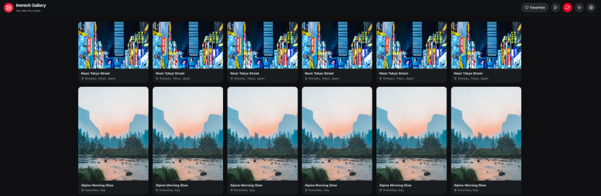

# Immich Pinterest

A lightweight, zero-dependency, Pinterest-style masonry photo feed that pulls random memories and photographs directly from your local [Immich](https://immich.app/) instance.

Built with **plain HTML, CSS, and modern JavaScript** (no `npm` or build steps required).



---

## Features

- **Pinterest-Style Masonry Grid**: Dynamic multi-column layout using a native CSS/JS masonry grid with zero layout shift.
- **Random Photo Feed**: Pulls random assets directly from Immich's `POST /api/search/random` endpoint.
- **Instant Shuffle**: Click **Shuffle (R)** to instantly refresh the feed with a fresh set of random memories.
- **Detailed Lightbox Modal**:
  - Full-resolution preview
  - Rich EXIF metadata drawer (Camera body, lens, exposure time, f-stop, ISO, focal length, date taken, location, original file path)
  - Direct deep link to open the photo in Immich Web UI (`/photos/{id}`)
  - Download original image button
  - Copy link button
- **Favourites Filter**: Filter your random feed to only display favourited memories.
- **Ambient Slideshow Mode (S)**: Fullscreen ambient photo viewer with smooth transitions, progress bar, and play/pause controls.
- **Dark & Light Themes**: Adapts automatically to your OS preference with manual override.
- **Demo Mode**: Test and preview the interface immediately with sample photography even before configuring your Immich API key.

---

## Quick Start

Because this app uses standard Web standards and ES modules, you can serve it with any simple static server or open it directly:

### Option 1: Docker (Recommended for Home Server)
```bash
# On your server, edit port in docker-compose.yml if already using 8080
docker compose up -d --build
```
Access at `http://<server-ip>:8041` or via Traefik hostname.

### Option 2: Python Local Server
```bash
python3 server.py
```
Access at `http://localhost:8080`.

---

## Setting Up Your Immich API Key

1. Open your Immich web interface.
2. Go to **Account Settings** -> **API Keys**.
3. Click **New API Key**, give it a name (e.g., *Pinterest Web App*), choose `Asset: Read`, `Asset: View`, and `Asset: Update` (to save favourites) as permissions, and copy the generated key.
4. In the **Immich Pinterest** app, click the **Settings** button in the top right.
5. Paste your Server URL and API Key and verify connection using the **Test Connection** button.
6. Click **Save & Reload**!

---

## Keyboard Shortcuts

| Key | Action |
| --- | --- |
| `R` | Shuffle and reload random photos |
| `S` | Toggle Fullscreen Slideshow |
| `Left Arrow` / `Right Arrow` | Previous / Next photo in Modal or Slideshow |
| `Space` | Pause / Resume slideshow |
| `Esc` | Close Modal or Exit Slideshow |

---

## Project Structure

```
Immich Pinterest/
├── index.html       # Semantic HTML5 entrypoint
├── screenshot.png   # Gallery screenshot preview
├── css/
│   └── style.css    # Responsive masonry design system and theme variables
├── js/
│   ├── api.js       # Immich API client, authentication and demo generator
│   ├── grid.js      # Masonry and infinite scroll controller
│   └── app.js       # Main application state and UI interactions
├── Dockerfile       # Docker container definition
├── docker-compose.yml # Docker Compose configuration
├── server.py        # Concurrent multi-threaded proxy server
├── .gitignore       # Git ignore configuration
└── README.md        # Documentation
```
